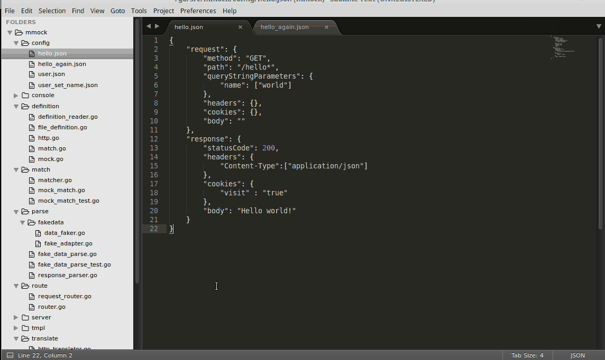
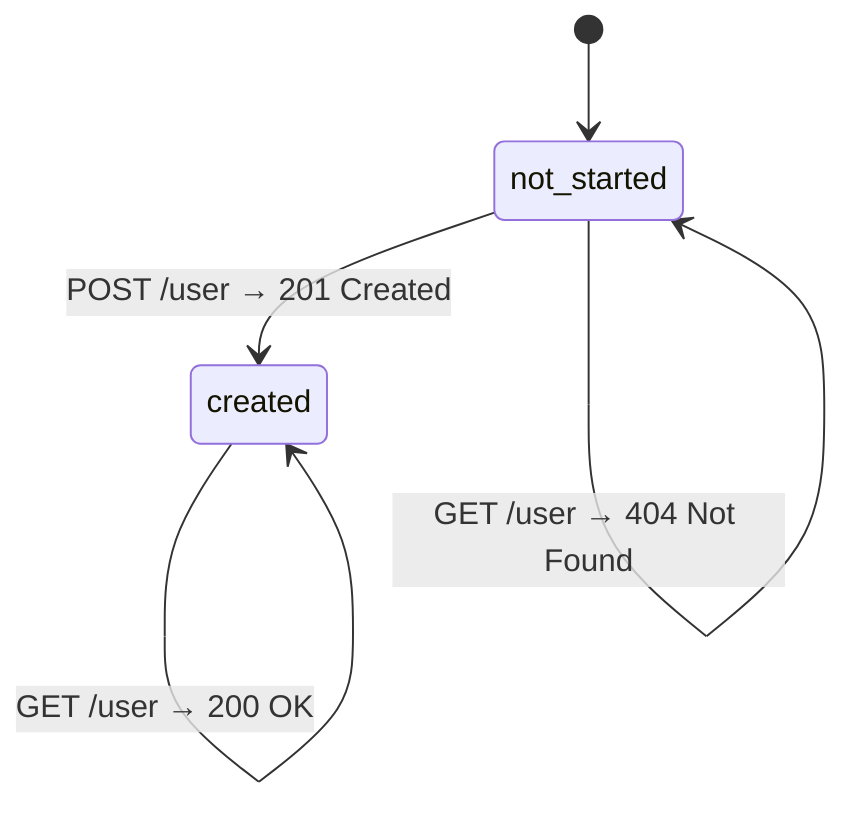

<p align="center">
  
</p>

<h1 align="center">Mmock</h1>

<p align="center">
  A fast, lightweight HTTP mock server for testing and prototyping.
</p>

<p align="center">
  <a href="https://github.com/jmartin82/mmock/actions/workflows/ci.yml"></a>
  <a href="https://hub.docker.com/r/jordimartin/mmock/"></a>
  <a href="LICENSE.md"></a>
</p>

Mmock lets you stand up a fake HTTP server in seconds:

1. Download Mmock.
2. Create a mock definition (JSON or YAML).
3. Point your application at Mmock instead of the real endpoint.
4. Get back the responses you defined.
5. Inspect every request that came in, live, from the web UI.
6. When you're ready, swap Mmock out for the real server.

Mmock is written in Go and ships as a single, dependency-free binary — no installation required, runs on Linux, macOS and Windows.

## Table of contents

- [Features](#features)
- [Quick example](#quick-example)
- [Getting started](#getting-started)
  - [Run with Docker](#run-with-docker)
  - [Run locally](#run-locally)
  - [Command-line flags](#command-line-flags)
  - [Logging](#logging)
- [Mock definition](#mock-definition)
  - [Request](#request)
  - [Response](#response-optional-on-proxy-calls)
  - [Callback](#callback-optional)
  - [Control](#control-optional)
- [Variable tags](#variable-tags)
- [Scenarios](#scenarios)
- [API](#api)
  - [Verify](#verify)
  - [Scenario](#scenario)
  - [Mapping](#mapping)
  - [Realtime endpoint](#realtime-endpoint)
  - [Response format](#response-format)
- [Statistics](#statistics)
- [Contributors](#contributors)
- [Contributing](#contributing)
- [License](#license)

## Features

- Easy mock definitions in JSON or YAML
- Dynamic responses with variables (fake data, request data, environment data)
- Route patterns with named parameters (`/hello/:name`)
- Glob matching (`*hello*`)
- Match requests by method, URL params, query string, headers, cookies and body
- Hot reload — edit your mocks on disk and Mmock picks them up, no restart needed
- Web console to inspect requests (method, path, headers, cookies, body, etc.)
- Stateful behavior via scenarios
- Request verification API
- Proxy mode
- Fine-grained logging in the web console
- Real-time request stream over WebSockets
- Priority-based matching
- "Crazy mode" for chaos/failure testing
- Auto-discovery of the public interface
- Lightweight, portable, single binary — no installation required

## Quick example



A mock definition in JSON:

```json
{
  "request": {
    "method": "GET",
    "path": "/hello/*"
  },
  "response": {
    "statusCode": 200,
    "headers": {
      "Content-Type": ["application/json"]
    },
    "body": "{\"hello\": \"{{request.query.name}}, my name is {{fake.FirstName}}\"}"
  }
}
```

The same mock in YAML:

```yaml
---
request:
  method: GET
  path: "/hello/*"
response:
  statusCode: 200
  headers:
    Content-Type:
      - application/json
  body: '{"hello": "{{request.query.name}}, my name is {{fake.FirstName}}"}'
```

More complete examples are available in [`/config`](/config).

## Getting started

### Run with Docker

Use the provided `Dockerfile`, or pull the image from [Docker Hub](https://hub.docker.com/r/jordimartin/mmock/):

```bash
docker image pull jordimartin/mmock
docker run -v YOUR_ABS_PATH:/config -p 8082:8082 -p 8083:8083 jordimartin/mmock
```

### Run locally

Requires Go 1.23 or later (see [`go.mod`](go.mod)):

```bash
go install github.com/jmartin82/mmock/v3/cmd/mmock@latest
mmock -h
```

### Command-line flags

```text
Usage of ./mmock:
  -config-path string
        Mocks config folder (default "execution_path/config")
  -console
        Console enabled  (true/false) (default true)
  -console-ip string
        Console server IP (default "public_ip")
  -console-port int
        Console server Port (default 8082)
  -request-storage-capacity int
        Request storage capacity (0 = infinite) (default 100)
  -results-per-page uint
        Number of results per page (default 25)
  -server-ip string
        Definition server IP (default "public_ip")
  -server-port int
        Definition server Port (default 8083)
  -server-statistics
        Definition server sends anonymous statistics (default true)
  -server-tls-port int
        Definition server TLS Port (default 8084)
  -tls-key-password string
        Password for encrypted TLS private key files (can also be set via MMOCK_TLS_KEY_PASSWORD env var)
  -tls-path string
        TLS config folder (server.crt and server.key should be inside) (default "execution_path/tls")
```

### Logging

The default logging level is `INFO`. Override it with the `LOG_LEVEL` environment variable, set to one of:

`CRITICAL` · `ERROR` · `WARNING` · `NOTICE` · `INFO` · `DEBUG`

## Mock definition

```json
{
  "description": "Some text that describes the intended usage of the current configuration",
  "request": {
    "host": "example.com",
    "method": "GET|POST|PUT|PATCH|...",
    "path": "/your/path/:variable",
    "queryStringParameters": {
      "name": ["value"],
      "other": ["value1", "value2"]
    },
    "headers": {
      "name": ["value"]
    },
    "cookies": {
      "name": "value"
    },
    "body": "Expected Body"
  },
  "response": {
    "statusCode": "int (2xx,4xx,5xx,xxx)",
    "headers": {
      "name": ["value"]
    },
    "cookies": {
      "name": "value"
    },
    "body": "Response body"
  },
  "callback": {
    "method": "GET|POST|PUT|PATCH|...",
    "url": "http://your-callback/",
    "delay": "string (response delay in s,ms)",
    "headers": {
      "name": ["value"]
    },
    "body": "Response body"
  },
  "control": {
    "scenario": {
      "name": "string (scenario name)",
      "requiredState": [
        "not_started (default state)",
        "another_state_name"
      ],
      "newState": "new_state_name"
    },
    "proxyBaseURL": "string (original URL endpoint)",
    "delay": "string (response delay in s,ms)",
    "crazy": "bool (return random 5xx)",
    "priority": "int (matching priority)",
    "webHookURL": "string (URL endpoint)"
  }
}
```

### Request

A core feature of Mmock is returning canned HTTP responses for requests that match a set of criteria.

| Field | Description |
|---|---|
| `host` | Request HTTP host (without port). |
| `method` **(required)** | Request HTTP method. Multiple methods can be separated with `\|`. |
| `path` **(required)** | Resource identifier. Supports `:value` named parameters. |
| `queryStringParameters` | Query string values. Multiple values per key are supported. |
| `headers` | Request headers. Multiple values per key are supported. **Case sensitive.** |
| `cookies` | Request cookies. |
| `body` | Body string. Supports `*` glob patterns and regular expressions for field values inside JSON bodies. |

For `queryStringParameters`, `headers` and `cookies`, a request only matches if every key defined in the mock is present with the exact or glob value.

Glob matching (`*`) is supported for: `host`, `path`, `headers`, `cookies`, query strings and `body`.

Query strings and headers also support glob matches in the key name itself, for example:

```json
"headers": {
  "Custom-Header-*": ["partial val*"]
}
```

Regular-expression matching is supported for `body` and query strings — see the [Go regexp syntax reference](https://pkg.go.dev/regexp/syntax).

### Response (optional on proxy calls)

| Field | Description |
|---|---|
| `statusCode` | Response status code. |
| `headers` | Response headers. Multiple values per key and variable tags are supported. |
| `cookies` | Response cookies. Variable tags are supported. |
| `body` | Response body. Variable tags are supported. |

### Callback (optional)

Makes Mmock issue an outgoing API request after it serves the mocked response.

| Field | Description |
|---|---|
| `delay` | Delay before making the callback. |
| `url` | URL to call. |
| `method` | HTTP method for the callback request. |
| `headers` | Callback request headers. Multiple values per key are supported. |
| `body` | Callback body. Variable tags are supported. |
| `timeout` | How long to wait for the callback to respond (default `10s`). |

### Control (optional)

| Field | Description |
|---|---|
| `scenario` | A state machine; see [Scenarios](#scenarios). |
| `proxyBaseURL` | Forwards the request to this base URL and relays the response back to the client. Useful when you don't want to mock an entire service — the `response` field isn't required in this case. |
| `delay` | Delays the response, to simulate a slow connection or server. |
| `crazy` | Returns random `5xx` errors on some requests, to simulate server problems. |
| `priority` | Matching priority. Higher values are matched first, ahead of less specific mocks. |
| `webHookURL` | If set, notifies this endpoint whenever this mock is matched. |

## Variable tags

Response bodies, headers and cookies can embed dynamic values as `{{tagName}}` tags.

**General:**

- `URI`
- `description`

**Request data** — pull data from the incoming request into the response:

- `request.scheme`
- `request.hostname`
- `request.port`
- `request.path` (full path)
- `request.path."*key*"`
- `request.query."*key*"`
- `request.cookie."*key*"`
- `request.fragment`
- `request.url` (full URL: scheme, hostname, port, path and query parameters)
- `request.authority` (scheme, hostname and port, if present)
- `request.body`

You can also pull values out of the request body with a dot-notation path:

- `request.body."*key*"` (supports `application/json`, `application/xml` and `application/x-www-form-urlencoded`)
- `request.body."*deep*"."*key*"` (supports `application/json` and `application/xml`)

See the [gjson path syntax](https://github.com/tidwall/gjson#path-syntax) for the full extraction syntax. You can also combine `regex()` and `concat()` to post-process the extracted value:

- `request.body."*deep*"."*key*".regex()`
- `request.body."*deep*"."*key*".concat()`
- `request.body."*deep*"."*key*".regex().concat()`

**Example — incoming request body:**

```json
{
  "email": "hilari@sapo.pt",
  "age": 4,
  "uuid": "2307-878787-xxxx",
  "discarded": "do not return"
}
```

**Example — mock response using variable tags:**

```json
{
  "email": "{{request.body.email.regex((\@gmail.com))}}",
  "age": {{request.body.age}},
  "uuid": "{{request.body.uuid.regex(\b([0-9a-zA-Z]{4})\b).concat(-878787)}}",
  "discarded": "{{request.body.discarded.concat(, Please!)}}"
}
```

**Resulting response:**

```json
{
  "email": "",
  "age": 4,
  "uuid": "2307-878787",
  "discarded": "do not return, Please!"
}
```

**External streams** — handy for embedding large payloads or pulling data from another service:

- `file.contents(FILE_PATH)`
- `http.contents(URL)`

**[Fake](https://godoc.org/github.com/icrowley/fake) data** — generates rich, randomized values:

<details>
<summary>Full list of <code>fake.*</code> tags</summary>

| | | |
|---|---|---|
| `fake.Brand` | `fake.Character` | `fake.Characters` |
| `fake.CharactersN(n)` | `fake.City` | `fake.Color` |
| `fake.Company` | `fake.Continent` | `fake.Country` |
| `fake.CreditCardVisa` | `fake.CreditCardMasterCard` | `fake.CreditCardAmericanExpress` |
| `fake.Currency` | `fake.CurrencyCode` | `fake.Day` |
| `fake.Digits` | `fake.DigitsN(n)` | `fake.EmailAddress` |
| `fake.FirstName` | `fake.FullName` | `fake.LastName` |
| `fake.Gender` | `fake.Hex(n)` (random hex string, `n` chars) | `fake.IPv4` |
| `fake.Language` | `fake.Model` | `fake.Month` |
| `fake.MonthShort` | `fake.MonthNum` | `fake.Year` |
| `fake.Paragraph` | `fake.Paragraphs` | `fake.ParagraphsN(n)` |
| `fake.Phone` | `fake.Product` | `fake.Sentence` |
| `fake.Sentences` | `fake.SentencesN(n)` | `fake.SimplePassword` |
| `fake.State` | `fake.StateAbbrev` | `fake.Street` |
| `fake.StreetAddress` | `fake.UserName` | `fake.WeekDay` |
| `fake.Word` | `fake.Words` | `fake.WordsN(n)` |
| `fake.Zip` | `fake.Int(n)` (random positive int `<= n`) | `fake.IntMinMax(min, max)` |
| `fake.Float(n)` (random positive float `< n`) | `fake.UUID` | |

</details>

## Scenarios

Scenarios let you simulate a stateful service, which makes them handy for building test doubles. A scenario is a state machine that you can move between arbitrary, named states.

When Mmock receives a request, it checks whether the mock's `requiredState` matches the scenario's current state. If it matches, Mmock serves the mock and — if `newState` is set — advances the scenario to that new state. Every scenario starts in the `not_started` state until a mock transitions it elsewhere.

Example: a minimal CRUD flow for `/user`, modeled as a scenario with two states:



In this scenario: while the state is `not_started`, a mock with `requiredState: not_started` answers `GET /user` with `404` (nothing has been created yet). `POST /user` matches a mock with `requiredState: not_started` and `newState: created`, moving the scenario to `created`. From then on, `GET /user` matches a different mock — the one with `requiredState: created` — and returns `200`.

Working examples are available in [`/config/crud`](/config/crud).

## API

Mmock describes its HTTP API using the OpenAPI Specification (OAS, formerly Swagger). The spec is served at `/swagger.json` and is the canonical reference for every available endpoint — point any [OpenAPI tool](https://github.com/swagger-api) at it to generate clients, docs, or test suites.

### Verify

Mmock keeps the last N requests it has received in memory (100 by default, see `-request-storage-capacity`), so you can verify that a given request was made and inspect its details.

| Action | Method | URL | Success |
|---|---|---|---|
| Get all requests | `GET` | `/api/request/all` | `200 OK` |
| Get all matched requests | `GET` | `/api/request/matched` | `200 OK` |
| Get all unmatched requests | `GET` | `/api/request/unmatched` | `200 OK` |
| Clear all recorded requests | `GET` | `/api/request/reset` | `200 OK` |
| Get requests matching a pattern | `POST` | `/api/request/verify` | `200 OK` |
| Reset requests matching a pattern | `POST` | `/api/request/reset_match` | `200 OK` |

The `verify` and `reset_match` endpoints take a request pattern using the same DSL as a mock's `request` block:

```json
{
  "host": "example.com",
  "method": "GET|POST|PUT|PATCH|... (required)",
  "path": "/your/path/:variable (required)",
  "queryStringParameters": {
    "name": ["value"],
    "other": ["value1", "value2"]
  },
  "headers": {
    "name": ["value"]
  },
  "cookies": {
    "name": "value"
  },
  "body": "Expected Body"
}
```

### Scenario

| Action | Method | URL | Success |
|---|---|---|---|
| Get all active scenarios | `GET` | `/api/scenarios` | `200 OK` |
| Reset every scenario's state and pause flag | `GET` | `/api/scenarios/reset_all` | `200 OK` |
| Manually move a scenario to a given state | `PUT` | `/api/scenarios/set/:scenario/:state` | `200 OK` |
| Pause all scenario state machines | `PUT` | `/api/scenarios/pause` | `200 OK` |
| Resume all scenario state machines | `PUT` | `/api/scenarios/unpause` | `200 OK` |

### Mapping

Manage your mock definitions remotely:

| Action | Method | URL | Success |
|---|---|---|---|
| Get all mock definitions | `GET` | `/api/mapping` | `200 OK` |
| Create a mock definition | `POST` | `/api/mapping/:uri` | `201 Created` |
| Get a mock definition | `GET` | `/api/mapping/:uri` | `200 OK` |
| Update a mock definition | `PUT` | `/api/mapping/:uri` | `200 OK` |
| Delete a mock definition | `DELETE` | `/api/mapping/:uri` | `200 OK` |

### Realtime endpoint

A WebSocket endpoint broadcasts every request in real time:

| Action | URL |
|---|---|
| Stream all requests | `/echo` |

### Response format

All of the endpoints above share the same JSON response shape:

```json
[
  {
    "time": 1486563983,
    "request": {
      "host": "192.168.20.209",
      "method": "GET",
      "path": "/hello",
      "queryStringParameters": {},
      "headers": {
        "Accept": [
          "text/html,application/xhtml+xml,application/xml;q=0.9,image/webp,*/*;q=0.8"
        ]
      },
      "cookies": {},
      "body": ""
    },
    "response": {
      "statusCode": 200,
      "headers": null,
      "cookies": {
        "visit": "true"
      },
      "body": "Hello world!"
    },
    "result": {
      "match": true,
      "errors": null
    }
  }
]
```

## Statistics

Mmock collects anonymous usage statistics (see [`internal/statistics/statistics.go`](https://github.com/jmartin82/mmock/blob/master/internal/statistics/statistics.go#L30)):

- `requests.mock` — mocks served (count)
- `requests.console` — web console usage (count)
- `requests.verify` — verify requests (count)
- `feature.scenario` — mocks served that use the scenario feature (count)
- `feature.proxy` — mocks served that use the proxy feature (count)

Disable this entirely with `-server-statistics=false`.

## Contributors

- Amazing request body parsing from [@hmoragrega](https://github.com/hmoragrega)
- Awesome usage statistics from [@alfonsfoubert](https://github.com/alfonsfoubert)
- More request variables thanks to [@Bartek-CMP](https://github.com/Bartek-CMP)
- Scenario pause feature thanks to [@Nekroze](https://github.com/Nekroze)
- Storage reset feature thanks to [@rubencougil](https://github.com/rubencougil)
- Improved Docker image thanks to [@daroot](https://github.com/daroot)
- Array index access in dynamic responses thanks to [@jaimelopez](https://github.com/jaimelopez)
- Mapping creation via the console thanks to [@inabajunmr](https://github.com/inabajunmr)
- Bug fixes thanks to [@joel-44](https://github.com/joel-44)
- Environment variables as mock variables thanks to [@marcoreni](https://github.com/marcoreni)
- Regular expression support for JSON request body fields thanks to [@rosspatil](https://github.com/rosspatil)
- Improved logging with levels thanks to [@jcdietrich](https://github.com/jcdietrich) and [@jdietrich-tc](https://github.com/jdietrich-tc)
- Regular expression support for query string parameters thanks to [@jcdietrich](https://github.com/jcdietrich) and [@jdietrich-tc](https://github.com/jdietrich-tc)
- URI and description tag support thanks to [@jcdietrich](https://github.com/jcdietrich) and [@jdietrich-tc](https://github.com/jdietrich-tc)

## Contributing

Mmock is distributed as a Go module and targets the Go version declared in [`go.mod`](go.mod) (currently Go 1.23+).

Before submitting a pull request:

```bash
go fmt ./...
go vet ./...
go test ./...
```

## License

Copyright © 2016–2020, Jordi Martín ([jordi.io](http://jordi.io))

Released under the MIT license — see [LICENSE](LICENSE.md) for details.
